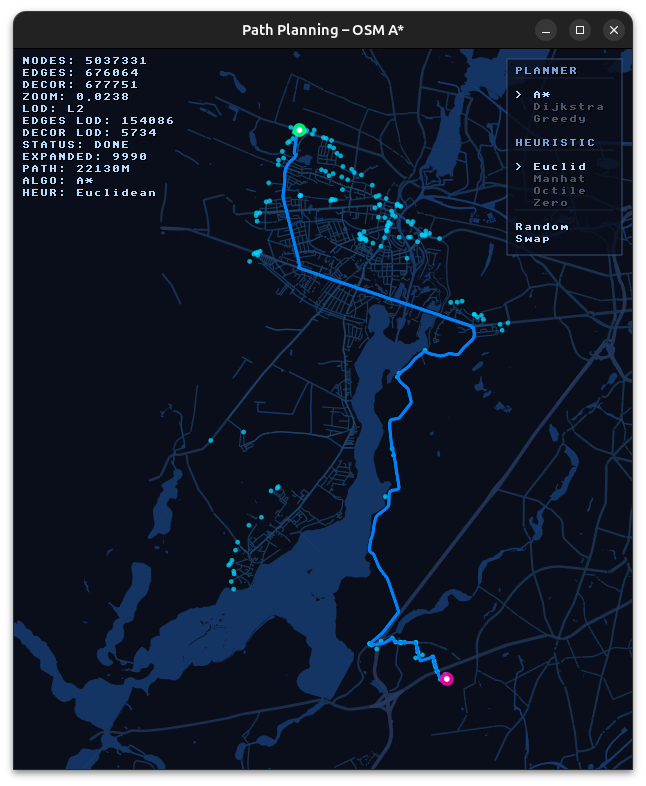
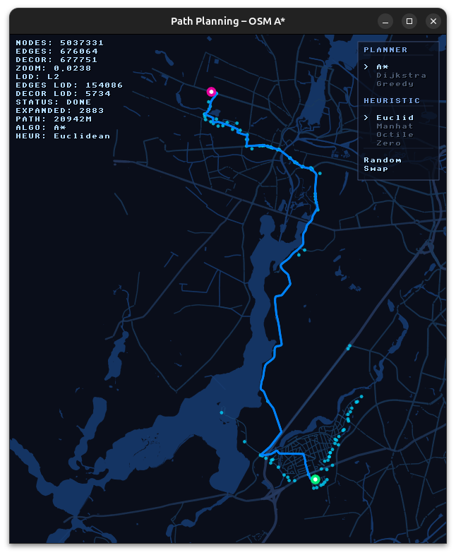
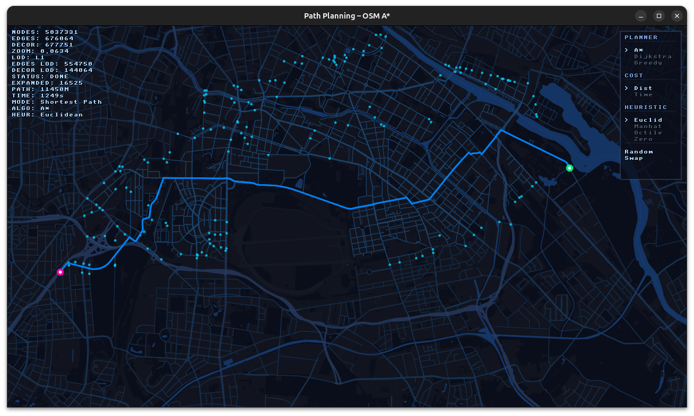
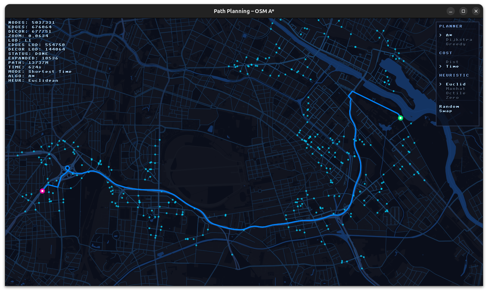

# pathplanning

[](https://github.com/sunsided/pathplanning/actions/workflows/ci.yml)
[](https://www.rust-lang.org/)
[](https://joinup.ec.europa.eu/collection/eupl/eupl-text-eupl-12)
[](https://github.com/linebender/vello)
[](https://github.com/rust-windowing/winit)

Path planning playground on [Berlin OSM (2026-04-25)](https://download.geofabrik.de/europe/germany/berlin.html).


## Directed Graph

Planning is on the directed graph of the Berlin road network.

| A*                                                                                                                               | A* (reverse)                                                                                                                  |
|----------------------------------------------------------------------------------------------------------------------------------|-------------------------------------------------------------------------------------------------------------------------------|
|  |  |

## Usage

### Running

```bash
cargo run --release -- [path/to/map.osm.pbf]
```

Defaults to `maps/berlin.osm.pbf` if no argument is given.

### Web build

The app can be built for the browser with WebAssembly. It requires WebGPU (current Chrome/Edge; Firefox/Safari support varies), because Vello renders through compute shaders. There is no WebGL2 fallback: if `navigator.gpu.requestAdapter()` returns `null`, the page cannot render. On Linux Chrome, if `chrome://gpu` reports WebGPU as accelerated but the adapter is still `null`, launch Chrome with `--enable-features=ForceEnableWebGpuInterop --ignore-gpu-blocklist`; for software rendering use `--enable-unsafe-webgpu --enable-features=Vulkan,WebGPU --use-webgpu-adapter=swiftshader --use-vulkan=swiftshader --ignore-gpu-blocklist`. You need `rustup target add wasm32-unknown-unknown` and `wasm-pack`.

```bash
# Export a compact graph asset + build the wasm module + serve it
task -t Taskfile.dist.yaml web:serve
```

Then open <http://127.0.0.1:8081>. The map is clipped to a central Berlin bounding box by default (`WEB_BBOX` in `Taskfile.dist.yaml`) to keep the download small. To build the deployable tree without serving it:

```bash
task -t Taskfile.dist.yaml web:dist   # writes dist/
```

The GitHub Pages workflow builds and deploys `dist/` on every push to `main`.

### Mouse Controls

| Action | Control |
|--------|---------|
| Place start marker | Left-click on map |
| Place end marker | Left-click again (second click) |
| Drag start/end marker | Left-click and drag on an existing marker |
| Pan the map | Left-click and drag on empty map area |
| Zoom | Mouse scroll wheel |
| Remove nearest marker | Right-click near a marker |

### Keyboard Controls

| Key | Action |
|-----|--------|
| `R` | Randomize — places start and end markers on two random routable nodes within the current viewport and triggers a search |
| `S` | Swap — swaps the start and end markers |
| `Q` / `Escape` | Clear all markers and reset the planner |
| `A` / `P` | Cycle forward through algorithms (`P` cycles backward) |
| `H` | Cycle forward through heuristics (shift+H for backward) — only active for algorithms that use heuristics |
| `C` | Cycle forward through cost modes (shift+C for backward) |
| `Backspace` | Re-run the search with current markers and configuration |
| `F1` | Toggle the HUD/debug overlay and menu panel |
| `0` | Auto-select LOD tier based on zoom level |
| `1` | Force LOD tier 0 (full detail, use with caution) |
| `2` | Force LOD tier 1 |
| `3` | Force LOD tier 2 (lowest detail) |

### HUD Menu

The top-right HUD panel provides clickable menu items to change planner configuration:

- **PLANNER** section: Select the pathfinding algorithm
- **COST** section: Select the cost function
- **HEURISTIC** section: Select the heuristic (greyed out for Dijkstra et al.)
- **Random**: Places random start/end markers (same as `R` key)
- **Swap**: Swaps start and end markers (same as `S` key)

## Algorithms

Nine pathfinding algorithms are available, selectable via the `A`/`P` keys or the HUD menu:

### A*

The default algorithm. Uses `f = g + h` where `g` is the actual cost from start and `h` is the heuristic estimate to goal. A* is optimal (guarantees shortest path) when the heuristic is admissible (never overestimates).

### Bidirectional A*

Runs two A* searches at once: a forward search from the start and a backward search from the goal over reversed edges (so one-way streets stay correct). Each step expands the side with fewer open nodes (Pohl's cardinality rule), which keeps the work balanced when one end sits in a denser part of the network. Both use the averaged potential `p(v) = (h(v, goal) - h(start, v)) / 2`, which lets the search stop as soon as the sum of both queue minima reaches the best meeting cost found so far. Optimal for consistent heuristics, and typically expands fewer nodes than unidirectional A* on long routes.

### MM (Meet in the Middle)

Bidirectional search by Holte et al. (2016). Each side orders its open list by `pr(n) = max(g + h, 2g)` with the full (not halved) heuristic, which guarantees neither search expands a node beyond the midpoint of the optimal cost — the two fronts visibly meet halfway. The side holding the smallest priority expands next; the search stops once the best meeting cost is no larger than `max(C, fmin_f, fmin_b, gmin_f + gmin_b)`. Optimal for admissible heuristics.

### NBS (Near-Optimal Bidirectional Search)

Bidirectional search by Chen et al. (2017). Expands one node from *each* side per step, choosing the pair that minimizes `max(f_f(u), f_b(v), g_f(u) + g_b(v))`, implemented with per-side *waiting* (by f) and *ready* (by g) queues and a rising lower bound. It is proven to expand at most twice as many nodes as any optimal front-to-end bidirectional search. Optimal for admissible heuristics.

### Contraction Hierarchies

Preprocesses the graph by contracting nodes in order of importance (edge difference plus contracted-neighbor count, with lazy updates), inserting shortcut edges wherever a contraction would destroy a shortest path; witness searches are bounded to 64 settled nodes. Queries are a bidirectional Dijkstra that only moves *up* the hierarchy and expand a few hundred nodes instead of hundreds of thousands; shortcuts are unpacked into original edges afterwards. The hierarchy is built per cost mode in the background right after startup and cached on the graph (about 4–8 s for the full Berlin graph in a release build, ~30 s in a debug build, well under a second for the web asset; see [Background preprocessing](#background-preprocessing)). The explored set is scattered across the map, since the search follows the hierarchy rather than geography. Does not use a heuristic.

When CH is selected, the map shows the hierarchy itself: the **Ranks** toggle in the HUD menu adds gold dots on the top 3% of nodes by contraction rank (bigger and brighter = more important; off by default), the forward and backward upward search trees are drawn as straight green and pink hierarchy edges (long lines are shortcuts), and the dashed yellow line is the path found in the hierarchy before shortcuts are unpacked into the blue road path.

### Dijkstra

Uses `f = g` only — equivalent to A* with a zero heuristic. Explores uniformly outward from the start, guaranteeing optimality but typically expanding significantly more nodes than A*. Useful for comparison and visualization of the search space.

### Greedy Best-First

Uses `f = h` only — ignores actual travel cost and expands toward the goal purely based on the heuristic. Fast but **not optimal**; the resulting path may be longer than necessary. Does not perform relaxation (first visit to a node is final).

### RRT

A Rapidly-exploring Random Tree sampler that grows a tree from the start node toward randomly sampled world positions. **Not optimal** — it finds a feasible path quickly but does not guarantee the shortest one.

- **Goal bias**: 5% of samples target the goal directly to ensure termination on reachable goals.
- **Nearest neighbor**: Uses an `rstar::RTree` spatial index for O(log n) nearest-tree-vertex lookups.
- **Focused sampling**: Samples uniformly from a workspace bbox around start and goal, expanding by 1.5× when the tree stalls (256 iterations without progress).
- **No heuristic**: RRT is sampling-based and does not use a heuristic estimate; the heuristic menu is greyed out (same as Dijkstra).
- **Graph-embedded**: The tree grows along existing directed road edges — "steering" means choosing the outgoing edge whose destination most reduces distance to the random sample.

### RRT*

An asymptotically optimal variant of RRT that improves path quality over time through **choose-parent** and **rewire** operations. **Not optimal immediately** — it starts with a feasible path like RRT but continuously refines it as more samples arrive, converging toward the optimal solution given enough iterations.

- **Choose-parent**: when inserting a new node, RRT* examines all tree vertices within a dynamic radius that have an edge to the new node, and picks the parent that minimizes total path cost — not just the spatially nearest one.
- **Rewire**: after insertion, RRT* checks whether the new node can serve as a cheaper parent for nearby tree vertices. If so, it repoints `came_from` and propagates the cost improvement to all descendants via BFS.
- **Anytime semantics**: unlike RRT (which stops on first goal reach), RRT\* keeps searching until its iteration budget is exhausted. The `locked_path` cost decreases (or stays equal) over time as rewiring discovers cheaper routes.
- **Graph-embedded**: rewiring is constrained to existing directed edges — we cannot draw new lines in continuous space. Gains are smaller than in free-space RRT\* but still meaningful: a node reached via a long detour can be re-parented once a shorter route materializes nearby.
- **Dynamic radius**: the neighborhood radius shrinks as the tree densifies using `r(n) = γ × √(log(n)/n)` with `γ = 2 × avg_edge_length`, floored at 50 m and capped at 2000 m.
- **No heuristic**: same as RRT and Dijkstra, the heuristic menu is greyed out.

## Heuristics

Heuristics estimate the remaining cost from a node to the goal. They are used by A*, Bidirectional A*, MM, NBS and Greedy Best-First. The geometric heuristics account for Web Mercator projection distortion by scaling distances with `cos(mean_latitude)` to return ground-true meters.

| Heuristic | Formula | Admissible? | Description |
|-----------|---------|-------------|-------------|
| **Euclidean** | `√(dx² + dy²)` | Yes | Straight-line distance. The most accurate for road networks with free directional movement. Web Mercator coordinates are scaled by `cos(mean_latitude)` to convert back to ground-true meters — without this correction, the heuristic overestimates (especially at Berlin's latitude ~52.5°) and A* returns suboptimal paths. |
| **Manhattan** | `dx + dy` | Yes | Sum of absolute axis differences. Overestimates on diagonal movement, making it inadmissible but sometimes faster. |
| **Octile** | `(dmax - dmin) + dmin × √2` | Yes | Accounts for diagonal movement on grids. Admissible and tighter than Manhattan. |
| **ALT** | `max_L max(d(L,t) − d(L,v), d(v,L) − d(t,L))` | Yes | Landmark lower bounds via the triangle inequality (Goldberg & Harrelson). Eight landmarks are picked by farthest selection within the central strongly connected component, and exact distances to and from each are precomputed per cost mode in the background right after startup (see [Background preprocessing](#background-preprocessing)). Consistent, and much tighter than straight-line distance — especially in time mode, where the geometric heuristics must assume motorway speed everywhere. When selected, the landmarks are drawn as orange squares labelled `L1`–`L8`. |
| **Zero** | `0` | Yes | Reduces A* to Dijkstra. Expands all reachable nodes uniformly. |

Default: **Euclidean**

## Background preprocessing

ALT landmarks and contraction hierarchies are built for both cost modes as soon as the app starts: landmarks first, then hierarchies. Each build is resumable and advances in ~10 ms slices per frame, so the UI stays responsive. Progress is listed bottom-left (`BUILDING HIERARCHY TIME 42%`), and each line disappears once its build is done. If a search needs a build that is not finished yet, that build jumps the queue and the search starts as soon as it completes; partially built jobs are never thrown away.

## Cost Functions

Cost functions determine what the planner optimizes for. Edge costs are derived from OSM road classification data.

### Shortest Path (Distance)



Minimizes total travel distance in meters. Edge cost = `edge.weight_meters`.

Produces the geometrically shortest route regardless of road speed limits or traffic conditions.

### Shortest Time



Minimizes estimated travel time. Edge cost = `edge.travel_time_s + stop_penalty`.

- `travel_time_s` is derived from the road class's maximum speed
- A **stop penalty** is added when traversing edges into nodes with 3+ outgoing connections (intersections), simulating deceleration/waiting time at junctions
- Uses a 90 km/h (25 m/s) ceiling for the heuristic's time estimation

Default: **Shortest Time**

## Cost × Heuristic Interaction

The heuristic's evaluation mode matches the active cost function:

- In **Shortest Path** mode, the heuristic returns distance in meters
- In **Shortest Time** mode, the heuristic returns `distance / MAX_SPEED_MPS` (time estimate)

This ensures the heuristic remains consistent with the cost function, preserving A* optimality guarantees when using admissible heuristics.

## Architecture

| Component | Description |
|-----------|-------------|
| `graph.rs` | Directed road graph with nodes, edges, and road classifications |
| `osm_loader.rs` | OSM PBF file parser and graph construction |
| `planner/` | Pathfinding algorithms (A*, Bidirectional A*, MM, NBS, Contraction Hierarchies, Dijkstra, Greedy, RRT, RRT*) with configurable heuristics and cost modes |
| `spatial_index.rs` | Nearest-node lookup for marker snapping |
| `view_index.rs` | R*-tree spatial index for viewport-based edge queries |
| `lod.rs` | LOD pyramid for multi-scale rendering |
| `camera.rs` | Web Mercator camera with zoom and pan |
| `renderer.rs` | Vello GPU renderer with edge styling, decoration rendering, and HUD |
| `projection.rs` | Web Mercator projection utilities |

## Visualization Layers

The renderer draws in the following order (back to front):

1. **Decorations** — Buildings, landuse, water, pedestrian areas
2. **Road edges** — Styled by road class (motorway, primary, residential, etc.)
3. **Explored edges** — Closed-set edges in dark blue
4. **Frontier nodes** — Open-set nodes as cyan dots
5. **Best path** — Neon cyan (updated during search)
6. **Locked path** — Electric blue (final path when search completes)
7. **Markers** — Green (start) and pink (end)
8. **Debug overlay** — Stats text (top-left)
9. **HUD menu** — Interactive configuration panel (top-right)

## Road Classes

Edges are styled by their OSM road classification:

- Motorway
- Primary
- Secondary
- Tertiary
- Residential
- Service
- Path
- Other

Each class has a distinct stroke width and color, and contributes different speed/stop-penalty values to the time-based cost function.
